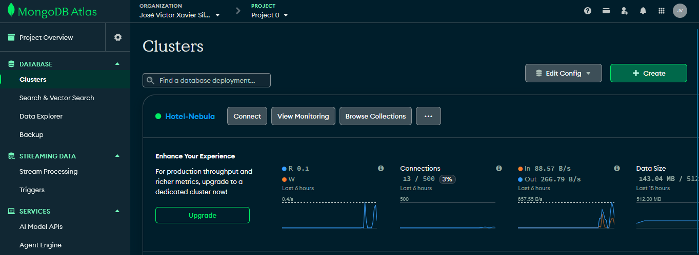
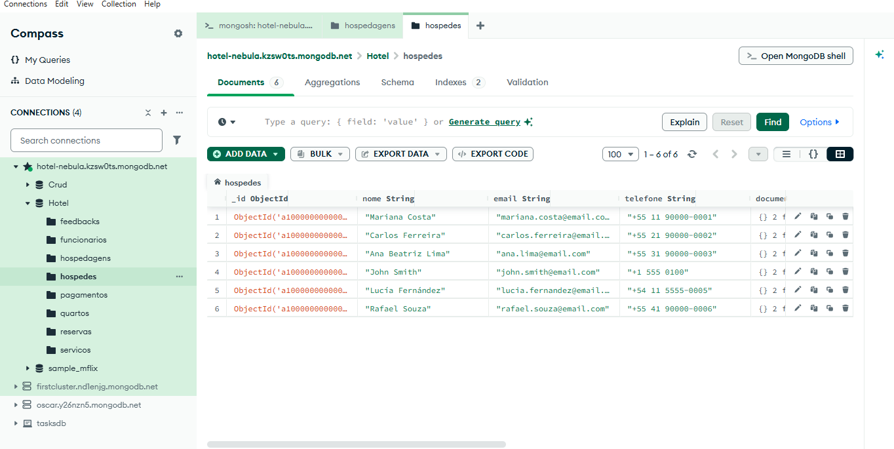
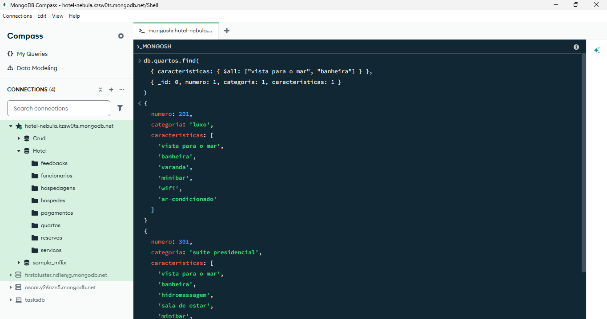
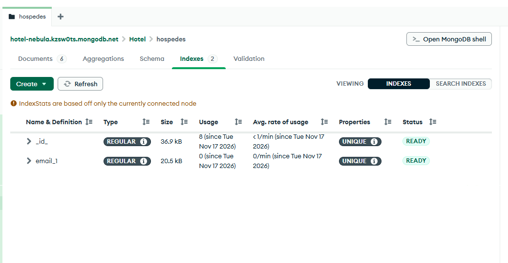

# Hotel Nebula — Banco de Dados Não Relacional (MongoDB)

Projeto de modelagem e implementação de um banco de dados de hotel usando MongoDB
Atlas e MongoDB Compass.

| Parte | Pasta | Conteúdo |
|---|---|---|
| 1 – Origem do Sistema | raiz do projeto | [`01-MODELAGEM.md`](01-MODELAGEM.md): padrões de acesso, coleções, justificativas, esquema e exemplos |
| 2 – Montagem do Núcleo | [`dados/`](dados/) | [`02-ARQUITETURA.md`](02-ARQUITETURA.md) e coleções exportadas em JSON |
| 3 – Radar de Comando | raiz do projeto | [`03-CONSULTAS.md`](03-CONSULTAS.md) com as consultas principais |

## Como executar

### 1. Criar o cluster no MongoDB Atlas

1. Acesse [MongoDB Atlas](https://www.mongodb.com/atlas) e crie uma conta ou entre
   na sua conta.
2. Crie um projeto e um cluster gratuito (**Free/Flex**, quando disponível).
3. Em **Database Access**, crie um usuário do banco e guarde a senha.
4. Em **Network Access**, adicione o seu endereço IP atual.
5. Em **Database → Connect → Compass**, copie a connection string e substitua
   `<password>` pela senha do usuário criado.

### 2. Conectar pelo MongoDB Compass

1. Abra o [MongoDB Compass](https://www.mongodb.com/products/tools/compass) e
   cole a connection string do Atlas.
2. Conecte-se e crie o banco `hotel_nebula` com uma primeira coleção, por
   exemplo `hospedes`.
3. Para cada arquivo em [`dados/`](dados/), abra a coleção
   correspondente (crie-a com o mesmo nome se necessário) e escolha
   **Add Data → Import JSON or CSV file**.
4. Selecione o arquivo JSON e mantenha o formato **JSON**. Os arquivos usam
   Extended JSON, portanto os campos `$oid` e `$date` serão importados como
   `ObjectId` e `Date`.
5. Importe primeiro `hospedes`, `quartos`, `funcionarios` e `servicos`. Depois
   importe `reservas`, `hospedagens`, `pagamentos` e `feedbacks`.

Os dados são carregados diretamente pelos arquivos JSON no Compass. A importação
não cria índices nem validações; crie os índices listados em
[`02-ARQUITETURA.md`](02-ARQUITETURA.md) pela aba **Indexes** de cada coleção.

### 3. Executar as consultas no Compass

1. Selecione o banco `hotel_nebula`.
2. Para consultas `find`, abra **Documents** e use a barra **Filter**; informe
   projeção, ordenação e limite nos campos correspondentes.
3. Para agregações, abra **Aggregations**, adicione cada estágio com **+ Add
   Stage** e copie os estágios descritos em [`03-CONSULTAS.md`](03-CONSULTAS.md).
4. Para conferir os documentos importados, use a aba **Documents** de cada
   coleção.

As consultas e os resultados esperados estão documentados em
[`03-CONSULTAS.md`](03-CONSULTAS.md).

## Evidências dos testes

As imagens abaixo registram testes realizados no MongoDB Compass:

### Cluster no MongoDB Atlas

### Coleção de hóspedes

### Consulta de quartos por características

### Index Hospedes (Email - unique)

Banco criado: `hotel_nebula`.
Coleções: `hospedes`, `quartos`, `funcionarios`, `servicos`, `reservas`, `hospedagens`, `pagamentos`, `feedbacks`.
